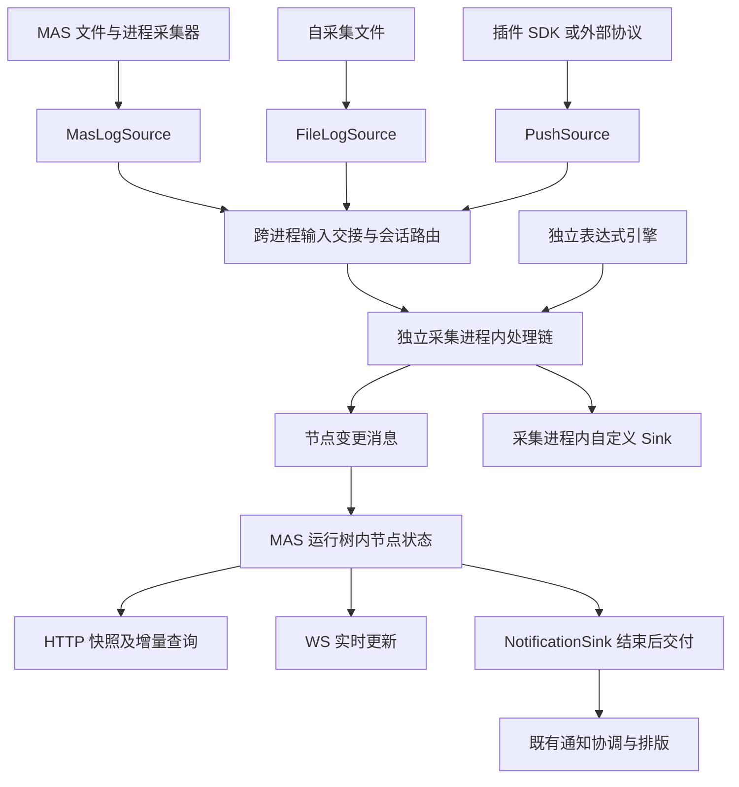

# LogFlow 日志节点重构计划

更新日期：2026-11-18。源码调查基线：`62da9ee56c9caa24eef53646e121a16ff591405e`，来自本轮 fetch 后的 `upstream/dev`。

本文规划让日志解析、协议上报、节点实时查询和通知共用 MAS 管理的接入链路。2026-11-18 后续讨论中，用户确认名称为 LogFlow、范围为可扩展日志节点管线，并选择整条管线在独立进程执行、有限等待收尾、超时发送明确不完整的报告。原先扩大为通用运行事件流和单进程管线的建议已撤回。**`feat/logflow` 已实现并在 Windows 验证内部采集闭环，尚未切换专项。** 用户提出的 15 项目标是需求基线；下文明确区分已确认决定和建议。接口细节与实施顺序尚可调整，文件名保留以维持已有链接。

文档保存在主仓 `docs/`，与现有插件迁移设计记录一起维护。[旧 LogBox 重构记录](log-box-refactor.md)只保留历史，不用其中旧类名推断当前能力。本计划不会自动改写现有 Skills 的现行接口要求；实施后须同步相关规范，避免两套规则并存。

## 1. 已确认决定与待确认问题

### 1.1 本轮用户已确认

| 编号 | 决定 | 设计影响 |
| --- | --- | --- |
| D1 | 实时查看，账号或任务结束后通知 | 流式产生节点不等于逐节点发通知；保持既有通知触发范围 |
| D2 | 首期仅运行期查询与断线重连 | 不建设跨 MAS 重启的事件恢复和补读；既有历史报告照常保存 |
| D3 | 插件宿主沿用现有信任和生命周期机制 | 早先接受进程内扩展的回答不再作为采集执行位置的结论；全部管线扩展按 D12 在独立进程执行 |
| D4 | 创建会话时选择 source/sink，首期不运行中热切换 | 支持不同会话使用不同组合，也支持同会话混合来源 |
| D5 | 保留采集总开关，通知独立控制 | 可以只实时观察、不发送节点通知；采集关闭仍不读文件、不运行处理器 |
| D6 | 同时扩展 Processor 和表达式自定义函数 | 两种扩展分别注册，避免把流程处理器误做成表达式内副作用函数 |
| D7 | 分开呈现节点观察结果、采集会话结束、MAS 执行完成 | 采集故障不改变上游任务成败 |
| D8 | 采集为独立进程，允许阻塞，不允许影响主程序执行 | 替换单进程方案及“拥塞立即停止观察分支”的建议；位置和收尾方式见 D11/D12，输入交接细节待定 |
| D9 | 倾向收缩到日志节点，同时保留插件自定义能力 | 此项经插件源码复核后由 D10 正式定案 |
| D10 | 接受 LogFlow 名称及可扩展日志节点管线边界 | 统一节点展示、查询、通知，允许插件自定义 source/process/sink、表达式函数及节点附加数据；其他业务沿用插件服务/API |
| D11 | 收尾等待有时限，超时发送明确不完整的报告 | 不无限等待阻塞管线；期限数值、迟到数据和强制退出清理细节另行定案 |
| D12 | 选择 B：整条管线在独立进程执行 | 自定义 source/process/sink 和表达式函数都在 worker；宿主仅保留注册、上下文绑定、节点接收和通知桥接 |
| D13 | 声明式接入为默认，MAS 原生覆盖大多数常规场景，必要时才自定义 | 插件/专项声明来源、规则和所需行为即可使用内置管线；worker、IPC、默认 sink 和关闭屏障由 MAS 提供，不成为普通插件接入的必写代码 |
| D14 | 当前基座存在限制且扩展基座明显更优时，允许扩展基座能力 | 比较公共能力扩展与局部适配的成本和责任归属，不把现有 SDK、日志分发或插件生命周期接口视为不可修改；本轮仍仅规划，实施限于 LogFlow 相关范围 |
| D15 | 包括组件命名在内，名称及实现组织可以按实际职责调整 | 原始名称用于表达需求，不作为必须沿用的类名、模块名或继承结构；采用符合 Python 和项目习惯的明确命名，不改变已确认能力和边界 |

### 1.2 建议，尚待确认

| 编号 | 问题 | 建议 | 影响 |
| --- | --- | --- | --- |
| Q3 | 插件能否扩展状态 | 可扩展节点种类及展示状态，但映射到有限的通用状态类别 | 旧消费者仍能展示、筛选；未知类型保留原文和命名空间 |
| Q5 | 协议首期范围 | Python SDK 直接上报；外部程序提供有会话凭证的 HTTP 批量上报；旧 stdout 标记在边界转换 | 不让旧插件立刻迁移；首期不同时开发多种等价网络传输 |
| Q6 | 首个迁移对象 | General + OkNte，分别验证 WebUI 配置和专项声明式配置 | 两条输入路径较早贯通；复杂账号与重试语义随后迁移 |

这些问题影响后续实现，不能把本节建议当作用户已批准的决定。未确认前可以继续盘点、整理契约和样本，不提前固定有争议的生产行为。

Q1/Q2/Q4 已分别由 D10/D11/D12 定案。独立进程数量（共享、每插件或每会话）、输入缓冲的存储预算/耗尽策略，以及阻塞采集器的退出期限尚未确认。D8 不能被理解为内存、磁盘无限或已承诺任意时长零丢失。

## 2. 当前实现及真实改造面

以下是本轮源码核查结果；文件链接指向调查时的责任位置。

| 当前责任 | 实际位置与行为 | 重构含义 |
| --- | --- | --- |
| 表达式引擎 | `app/utils/common/expression/{parser,evaluator,functions}.py`，已有编译、提取及函数链 | 引擎已经独立；需要稳定公开契约和扩展注册，无须另写一门语言 |
| 文本管线 | `app/utils/common/log_box/pipeline.py`，`feed()` 逐行处理，`finish()` 冲刷多行窗口、执行整批后处理、返回结果 | “全部结束才采集”不是内核唯一能力；当前实时交付和终态修正契约不足 |
| 文件源 | `app/utils/common/log/sources.py`，`open()/read_new()`，记录偏移，处理轮转、截断、未闭合行 | 复用已有文件身份和偏移语义，再补有界读取及连续驱动 |
| MAS 日志监控 | `app/utils/common/log/monitor.py`，监控文件/进程，预处理与回调、起始时间和轮转处理 | 在合适的采集边界分发原始新增记录，不能反读已裁剪的 UI 日志 |
| General | `app/task/general/AutoProxy.py`，WebUI 规则编译，回调内增量匹配，收尾写回结果；`log_protocol.py` 识别 `@@LOGBOX@@` | 现有路径部分已经增量处理；协议和表达式两条路径都须保留 |
| Okww / OkNte / BAAH | 各专项 `AutoProxy.py` 与 `push_log.py`，专项绑定来源、规则及后处理；例如 OkNte 收尾才 `read_new()` | 公共会话接管采集驱动和交付，不改变专项判定规则 |
| ZzzOd | `app/task/ZzzOd/push_log.py`，账号分段、重试终态归并、辅助指令过滤、告警与剩余电量 | 不能用“匹配即追加最终节点”替换有状态归并 |
| MaaEnd | `app/task/MaaEnd/AutoProxy.py`、`push_log.py`、`inventory_report.py`，阶段日志、节点及材料信息 | 保留阶段边界、材料通知和报告独立语义，不因统一节点丢附加内容 |
| BetterGI | `app/task/BetterGI/tools/push_log.py` 将既有权威分步表转成节点 | 使用已有结构化解析结果；不另造逐行正则判态器 |
| 报告排版 | `app/core/notify/report.py` 和 `app/models/notification/report.py` | 保留成功、跳过、失败、异常，及逐条时间戳、账号顺序、分组排序和普通附加文本 |
| 任务状态及 WS | `app/models/task.py` 的运行树、模型订阅和日志增量；`app/core/ws/publisher.py` | 节点查询接入运行树；Publisher 是出站传输，断连会丢消息，不是可补读的内部事件总线 |
| 插件宿主 | `app/plugin/base/plugin.py`、`services.py`、`calls.py`，`app/core/plugin/` | 复用服务、owner、调用准入和在途等待，不建设第二套插件管理器 |

本轮检索得到的节点接入专项包括 General、Okww、OkNte、BAAH、ZzzOd、MaaEnd、BetterGI。实施前还须追踪动态导入、SDK 导出及独立插件仓消费者；本表不是所有外部消费者均已验证的声明。

## 3. 架构取舍与 Flink 思路

采用独立采集进程、按运行会话隔离的 source → process → sink 框架；主程序持有会话登记、执行归属和节点查询状态。按 D12，全部插件管线代码在采集进程执行，宿主只做窄桥接。优点是采集与展示解耦、同一记录可以多消费、文本和结构化输入共用节点契约、公共收尾行为集中维护。新增成本包括子进程启动、实现加载、消息传输、缓冲、崩溃和重载交接；独立进程并不自动消除输入反压。现有插件实现核查和 A/B 成本比较见第 17 节。

借鉴 Flink 的流式处理、有状态算子、明确的生命周期和来源/处理/下沉分离。首期不引入分布式调度、跨进程 checkpoint、任意 DAG 编辑器、event-time watermark、通用窗口 SQL 或端到端 exactly-once。当前需求没有要求这些能力，且外部通知本就不具备可回滚事务。

Flink 的状态恢复依赖 checkpoint 与可重放来源等配套条件，不能仅靠 `open()/close()` 或一条队列取得这些保证。依据：[Apache Flink 状态流处理概念](https://nightlies.apache.org/flink/flink-docs-stable/docs/concepts/stateful-stream-processing/)。这项取舍是针对 MAS 场景的设计建议。

初期支持多来源、固定有序处理链、多 sink。独立链路需要不同规则时分别创建处理分支，不先实现任意图调度。表达式引擎继续作为纯能力，不负责账号、任务、通知或插件资源。



运行树内节点状态是宿主唯一可查询的节点投影；worker 保留解析所需状态，节点修订通过单向变更及确认同步，不由两端各自改写。宿主状态承接是框架必需步骤，不随用户更换 sink 被关闭。自定义 sink 消费处理器输出；需要依赖宿主已承接结果的 sink 等待对应序号确认。NotificationSink 在 worker 中生成最终交付请求，图中到通知系统的箭头经过宿主窄桥接，不在 worker 初始化 Notify。WS 只是通知变化，断线恢复依赖宿主快照与游标。

## 4. Python 模块组织与抽象

### 4.1 建议目录

```text
app/utils/common/expression/       # 保留纯解析、编译、求值；注入函数表
app/core/log_flow/
    __init__.py                   # MAS 组件单例与公开入口
    manager.py                    # 会话登记、插件归属、生命周期编排
    session.py                    # 每次运行独立会话、顺序处理和关闭
    contracts.py                  # 内部 Source / Processor / Sink 协议
    sources/                      # mas_log、file_log、push
    processors/                   # general_rule、rule_node、reported_node
    sinks/                        # notification 与宿主下沉适配
    registry.py                   # 带 owner 和代际的扩展工厂注册
    worker/                       # 独立入口、实现加载和管线执行；不初始化宿主单例
    bridge.py                     # 非阻塞消息交接和宿主能力桥接
app/models/log_flow.py             # 跨模块节点与进程消息模型
app/models/task.py                 # 运行节点挂载点及模型推送订阅
app/models/schema.py               # 共享 HTTP / WS 契约
app/api/log_flow.py                # 薄查询与协议入口，名称和路径以契约审定为准
```

上述文件仅为责任规划，按实际复杂度合并，不为每个类机械建文件。主框架先放在 `core/log_flow`；worker 入口必须能独立加载，导入不能顺带初始化 Config、Plugin 或通知单例。若确有独立基础框架和大量 MAS 扩展两种职责，再评估拆 `app/` 基础包。`core` 始终承担真实编排，不能退化成实例壳。表达式作为纯工具不得反向导入 core 或插件管理器。

### 4.2 抽象契约建议

Python 使用 `Protocol` 描述结构契约；需要共享实现时才用基类，不要求 Java 式深继承。公共方法保持 `open`、`close`，资源方法使用 async；同步表达式求值保持同步。接口草案不是已发布 SDK：

```python
class Source(Protocol):
    async def open(self, context: SourceContext) -> None: ...
    def records(self) -> AsyncIterator[InputRecord]: ...
    async def close(self, reason: CloseReason) -> None: ...

class Processor(Protocol):
    async def open(self, context: ProcessContext) -> None: ...
    async def process(self, record: InputRecord) -> Sequence[NodeChange]: ...
    async def close(self, reason: CloseReason) -> Sequence[NodeChange]: ...

class Sink(Protocol):
    async def open(self, context: SinkContext) -> None: ...
    async def write(self, changes: Sequence[NodeChange]) -> None: ...
    async def close(self, summary: SessionSummary) -> None: ...
```

Context 是不同阶段所需的窄接口，不暴露可随意改写的整套 Config。宿主组件单例负责创建会话，worker 内的执行实例每会话独立。跨进程 Context 仅包含可序列化快照及明确的请求协议，不能传入活 Config、绑定方法、闭包或通知单例。框架适配外部 push 为可消费记录，sink 无须拉取 source 或自己重复解析。接口草案描述 worker 内部 Python 协作；IPC 消息契约另行定义。

### 4.3 内置实现对照

| 设想 | Python 建议名 | 责任 |
| --- | --- | --- |
| baseSource | `Source` | 抽象，不作为实际数据源 |
| masLogSource | `MasLogSource` | 订阅宿主采集器提供的新增原始记录 |
| fileLogSource | `FileLogSource` | 封装并改进已有文件增量读取，支持自采集 |
| uploadSource | `PushSource` | 接收已验证的协议或 SDK 记录，绑定宿主会话 |
| 通用脚本配置处理 | `GeneralRuleProcessor` | 将 WebUI 配置编译为当前匹配语义，处理旧协议标记 |
| nodeDeclarationProcess | `RuleNodeProcessor` | 根据专项声明的规则提取节点，并执行翻译及必要的有状态归并策略 |
| uploadDataProcess | `ReportedNodeProcessor` | 将结构化上报映射到节点变更；不再走文本表达式 |
| process | `Processor` | 统一处理入口，允许插件扩展 |
| noticePushSink | `NotificationSink` | 经宿主桥接交付最终节点通知；名称不预设逐条即时推送 |
| sink | `Sink` | 抽象，允许插件扩展 |

`GeneralRuleProcessor` 与 `RuleNodeProcessor` 可共享匹配能力，但配置适配、校验错误和展示策略各自归属。不要因统一接口强制将两套配置序列化成同一份用户配置格式。

### 4.4 默认声明式接入与分级扩展

声明式接入是主要使用路径，Source/Processor/Sink 是框架及高级扩展契约。普通插件/专项不必为使用内置能力分别实现三个类，也不必登记自定义工厂、管理进程或编写 IPC。MAS 根据声明选择内置实现、校验并编译配置、注入执行上下文、启动 worker 和组织收尾；主程序的原生接入与插件使用同一套公开声明能力。

| 接入级别 | 插件/专项需要提供什么 | MAS 承担什么 |
| --- | --- | --- |
| 默认声明式 | 来源选择及必要参数、匹配/提取规则、节点类型、已有翻译资源、归属与报告选项 | 选择内置 source/process/sink，编译表达式，绑定本次运行身份，读取/上报、查询、通知桥接、worker 及有限关闭 |
| 局部自定义 | 声明中仅替换原生能力不能覆盖的处理器、表达式函数或 source/sink | 继续提供其余内置链路、加载和进程管理；不要求重写整条管线 |
| 高级组合 | 声明多个来源与处理分支，并引用必要的自定义实现 | 保持统一节点、执行归属、生命周期及宿主桥接契约；不另建插件私有框架 |

内置声明至少覆盖 MAS 分发/文件/协议来源、现有单行与多行规则、表达式提取、前置过滤改写和翻译、内置节点类型、账号归属绑定、逐条/汇总报告及通知 sink。公共归并策略按真实接入方的复用需求补齐；不为消灭全部自定义而创造任意状态机 DSL，也不把专项私有判态搬成 MAS 通用规则。

General 的 WebUI 配置和专项 Python 声明分别适配到内部管线描述；不要求现有专项把规则改写成 WebUI JSON。宿主从已持锁的本次配置解析路径、开关和账号映射等声明参数，再把必要快照交给 worker。声明解析和内置编译由 MAS 承担，不因进程隔离把序列化责任逐项转给插件作者。

只有选用自定义 worker 实现时，才需要提供可独立加载的实现标识及可序列化的专用参数；仍复用内置组件的默认值和宿主绑定。BetterGI 等已有权威结构化结果可以使用内置协议 source/process 声明，再由执行侧上报已有结果，无须为此实现自定义 Source。

声明的公开挂载位置（例如独立的 LogFlow 声明类型、专项声明的可选字段或通用插件能力声明）在 SDK 设计时确定。优先比较能同时服务专项与普通插件的最小入口；若当前 `ScriptTypeDecl` 或插件注册生命周期不足，按 D14 扩展基座，不要求插件通过服务回调手动搭建默认管线。以上字段是能力清单，不是已冻结的 SDK 字段名。

接入验收必须包含一个仅使用内置声明的完整样例，以及一个只替换单个处理环节的样例。前者从实际宿主入口走到节点查询及最终通知，无插件自建 worker/IPC；后者证明自定义不会迫使其余内置组件一并重写。迁移保留既有专项最终展示语义，无法由内置能力等价表达的部分先保留必要自定义，不以简化声明为由删能力。

### 4.5 按职责命名及 Python 实现组织

LogFlow 与日志节点管线的职责一致，继续沿用。其他名称按实际行为调整，原始设想与新名称的对应保留在第 4.3 节；此处调整的是待实现设计，不修改已发布接口。

- `Processor` 替代 `ProcessFunction`：有状态实例负责处理与收尾，用处理器命名更明确，也避免与操作系统进程混淆；表达式中的函数仍称 function。
- `PushSource` 替代 `UploadSource`：接收 SDK 或协议主动提交的记录，“upload”容易被理解为上传文件。
- `RuleNodeProcessor` 替代 `NodeDeclarationProcess`：声明是配置方式，提取和归并节点才是执行职责；结构化节点上报使用 `ReportedNodeProcessor`。
- `NotificationSink` 替代 `NoticePushSink`：表达通知交付目的，具体时机由已确认的结束后聚合策略决定。
- 保留 source、processor、sink 这些有明确职责的抽象；Python 类型使用 `PascalCase`，模块和普通方法使用 `snake_case`。配置与外部 API 字段沿用项目所属契约的命名，不为统一外观改动既有字段。

不因存在一个概念就强制建立一个类或文件。纯映射、过滤和文本变换可用普通函数，由框架适配到处理链；确需状态、资源或前后处理时使用带生命周期的处理器。`Source/Processor/Sink` 优先是结构协议，不要求插件继承 Base/Abstract 多层基类；`open()/close()` 仍是主框架对外生命周期，简单声明式使用者不必实现空方法。目录拆分按真实职责和复杂度决定，不机械复制 Java 的 interface/abstract/impl/factory 层级。

尚未冻结的内部名称可以随职责澄清继续修订，无须逐个名称重新确认；涉及公开 SDK 兼容或已确认业务边界时，明确迁移影响。名称调整不能用来取消独立进程、声明式优先或最终报告兼容等已确认要求。

## 5. 表达式引擎与函数扩展

1. 保持现有编译及 `extract(text)` 契约，盘点字面量、正则、拼接、多行输出、函数链、空表达式和无命中的语义。
2. 将函数依赖作为编译环境传入，编译结果绑定该会话所用函数版本；不让执行中的表达式读取不断变化的全局可变函数表。
3. 内置函数保持既有名称。插件函数使用 `plugin_id:function_name` 等命名空间，语法细节先评估现有 parser，再冻结；禁止覆盖内置函数或其他插件函数。
4. 插件函数只做文本变换，明确参数数量、类型和错误；不用 `eval`，不通过表达式触发通知、网络或任务调度。函数在 worker 执行；普通子进程隔离阻塞及崩溃，不等于对文件、网络和系统权限提供安全沙箱。
5. 注册 `Processor` 和注册表达式函数是两项能力：前者可维护会话状态并产生节点，后者保持纯变换。
6. 引擎错误在规则编辑/声明加载时尽早暴露。运行期错误由处理会话报告采集故障，不静默把无效规则解释成没有节点。

首批实现复用 `compile_expression(..., extensions=...)`：旧调用沿用内置函数以及参数出错时跳过该次变换的行为；新会话可显式传入私有函数表，已编译表达式绑定当前函数。扩展函数的参数错误通过 `ExpressionEvaluationError` 交付给调用方；内置函数可显式启用 `strict_functions=True`。迁移存量规则时保留原有容错口径。函数名使用 `namespace:name`（例如 `.example-adapter:format("件")`）；命名空间使用 ASCII 字母、数字、下划线、点及连字符，首字符不能为点或连字符。插件身份和命名空间的绑定、重复注册校验由后续宿主装配层负责，不能直接将任意插件 ID 拼进表达式。

## 6. 节点与事件语义

### 6.1 三层数据

| 层 | 最小信息 | 用途 |
| --- | --- | --- |
| 输入记录 | 会话与 source 身份、source 序号/偏移、记录类型、原始内容、来源时间与接收时间 | 保留来源证据及重复识别依据 |
| 节点变更 | 节点 ID、执行轮次、revision、操作、类型、观察状态、文本、报告顺序及来源引用 | 支持新增、更新、撤回和最终确认 |
| 会话摘要 | 关闭原因、采集完整性、最终节点引用、各 sink 交付结果 | 区分执行结果、采集故障和通知故障 |

宿主绑定运行根 UUID、托管运行 UUID、用户运行 UUID 和具体执行记录/轮次；配置 ID 与展示账号名仅为属性。异步处理不能重新读取“当前账号”来决定交付对象。跨账号来源由适配器基于已有上游结果面输出账号归属，框架只验证合法归属，不推断上游私有状态。

### 6.2 内置与扩展类型

保留成功、失败、跳过、异常及普通说明/剩余体力等非节点文本。`log_type` 的报告筛选含义与节点状态分开，不能把旧 `LOG_TYPE_ERROR` 直接等同“这个节点失败”。

建议将 `kind`（节点种类）、`status`（展示状态）和 `stability`（观察中/已确认）分开。插件状态使用命名空间，并声明通用类别、显示文本与可选图标；无法识别时用普通说明展示原文，不丢弃。自定义状态不自动决定 MAS 执行成功率，也不能随意注入前端可执行组件。

### 6.3 修正与最终报告

节点变更建议支持 `upsert`、`remove`、`finalize`。同一节点以稳定 ID 和 revision 更新；事件序号是会话接收顺序，节点 revision 是内容版本，二者不混用。

例如首轮失败、第二轮成功，实时消费者可看到失败观察被更新；最终报告沿用该专项既有重试归并口径，仅显示最终应有的节点。不可即时撤回的外部通知默认只接收结束聚合结果。

旧整批后处理器可在迁移期间保留在边界内，运行期输出暂态，关闭时生成最终修订。不要每新增一行就把整个历史重新后处理。各专项转成增量归并后移除批量过渡实现；不要永久维护两套判定器。

### 6.4 三种完成信号

- 节点完成：上游结果面已报告该节点状态；后续重试能否修订由适配器声明。
- 采集会话结束：来源排空、处理器关闭、最终节点交付结束，也可能是取消或不完整。
- MAS 执行完成：由原调度器和脚本结果契约决定。

第三方可同时查询这三项。缺少匹配日志、协议 `flush`、文件 EOF 或采集故障都不能替代游戏执行完成。外部上报仅能影响绑定会话的观察数据，不能任意终止整个 MAS 任务。

## 7. open 和 close 的完整生命周期

1. 宿主持有本轮执行上下文，快照采集配置，分配会话 ID、扩展工厂与插件代际。
2. 先初始化状态承接和 sink，再初始化处理链，最后打开 source。source 在 open 阶段可记录起始偏移，消费在会话进入运行态后启动。
3. 多来源进入 worker 会话入口，保留各来源顺序；处理器在会话内串行更新自己的状态。读取、重处理和插件 sink 都不在宿主事件循环执行。
4. 正常执行结束后，宿主请求 source 停止持续接收并排空已接受数据；文件源完成有限的末尾读取。外部生产者必须用明确的关闭握手或宿主超时边界，不能无限等待。
5. 沿处理链顺序关闭：前级冲刷结果仍经过后级，最终多行窗口和后置归并只结算一次。随后将最终节点提交到所属运行记录。
6. 在统一的有限收尾预算内等待最终节点承接及 sink 结算；通知 sink 通过桥接将最终结果交既有报告路径。超时由宿主用已承接节点生成明确不完整的报告，不再等待 worker 才恢复执行。
7. 正常释放订阅、文件句柄、子进程资源、扩展引用及会话凭证；超时隔离该会话并停止接收，执行层按有限清理路径释放自己持有的资源。强制退出与剩余缓冲清理由宿主管理，不能成为遗留孤儿工作。

`close()` 多次调用等待同一个关闭结果和同一截止时间，不重复 flush、不重复通知，也不因每阶段重新计时累积成无限等待。取消时在该预算内完成必要交付，再继续传播取消；关闭失败须保留已成功采集部分和故障信息。初始化部分失败时按实际取得的资源逆序释放。

有限等待及超时不完整报告已由 D11 确认，具体期限与强制退出宽限期待定。建议超时后冻结宿主最终节点快照并使会话代际失效，拒绝晚到节点覆盖或二次发送报告；worker 退出确认前保留其资源登记。结束 worker 可以终止其中的卡死处理，但不能回滚自定义 sink 已发生的外部副作用，重启不得盲目重发。线程超时不能替代进程退出确认。

## 8. source、混合采集与总线

### 8.1 MAS 原生分发位置

优先在 `LogMonitor` 文件解码/进程 stdout 得到完整新增记录后、UI Hook/翻译/裁剪之前提供 opt-in 订阅。向消费者传不可变记录，附带来源身份、偏移或序号与执行上下文；现有主回调行为保持。

需要同时盘点文件和进程采集入口，不能只改文件监控便宣称覆盖 MAS 全部日志。原始记录与展示记录分成明确阶段，防止预处理执行两次；特定消费者若依赖展示阶段内容，必须显式选择。

不要用 `Publisher.send()` 分发内部采集记录：它依赖前端主连接，不提供断连缓存或重放。也不把 Config 信号改造成通用大日志传输机制。首期可以给采集器增加窄订阅接口；只有多个真实内部消费者需要公共总线时，才评估更大范围修改。

### 8.2 自采集与混合

保留 `FileLogSource`，复用现有轮转、截断、完整行、初始偏移和日期路径能力。源可以在会话开始时配置为 MAS 分发、自采集，或多源组合。文件末尾没有换行时，正常采集中保留；关闭时是否提交该尾段须在文件协议中明确，不能悄悄改掉旧行为。

同一物理日志默认只选一个读者；需要混合时声明覆盖范围。重复识别优先用来源身份、文件代际+字节范围或上报事件 ID，不能对文本做全局去重，否则相同文案的两次真实执行会丢失。

跨源没有共同身份的记录不承诺自动去重，也不承诺按来源墙钟全局排序。每个节点由明确的权威来源产生，另一个源补充信息；多源冲突由接入声明决定优先级，不能简单“最后到达覆盖一切”。

### 8.3 首期容量与故障建议

原始采集批次、多行窗口、输入队列、sink 缓冲、事件补读缓存均需有界；最终节点状态的业务保留与传输缓存分开，不因 WS 裁剪截掉最终报告。

当前节点状态也须有数量与载荷预算。资源耗尽是故障，必须明确报告，不静默裁掉旧节点后生成“完整”报告；预算须覆盖代表性真实运行，不能用很小的默认值破坏存量能力。

worker 内允许读取或 sink 阻塞，文件源可暂停读取。普通拥塞不按原建议直接停止观察分支；宿主不能同步等待堵塞的 IPC 写入。已有文件日志优先用文件引用、代际和偏移供 worker 拉取；仅存在于 stdout 或主动上报的记录则需异步缓冲交接。可选临时磁盘缓冲用于本轮积压，不承诺跨 MAS 重启恢复，故不改变 D2。缓冲预算、文件轮转保留和资源耗尽后的行为须一起确定；无法用有限内存同时保证任意时长阻塞、无损和生产者永不等待。

协议入口应明确区分“不阻塞 MAS 调度”和“调用者等待上报确认”。插件执行路径不能同步等待拥塞的 LogFlow 确认；SDK 非阻塞提交需要明确接受范围和失败结果。文件读取、stdout 排空、协议入站和节点回传都要验证反压不会传回主执行链。

同一会话先串行处理，不为每行创建 Task。批量读取限制字节及行数，慢 sink 有独立有界交付能力。Python `asyncio.Queue` 并非线程安全，线程来源通过所属事件循环交接；本仓 Python 为 3.12，不能直接依赖 3.13 才引入的 `Queue.shutdown()`。依据：[Python 3.12 asyncio 队列](https://docs.python.org/3.12/library/asyncio-queue.html)。

## 9. 插件扩展、协议与释放

默认接入由 MAS 读取声明并选择内置实现，不要求插件登记工厂。确需自定义时，通过插件宿主登记带 owner 的工厂：source、process、sink、表达式函数分别分类，标识带插件命名空间和契约版本。SDK 暴露公开声明、协议及宿主访问入口，插件不导入宿主私有具体实现。必要的插件声明属性及生命周期支持可按 D14 扩展；不能要求插件直接修改 core 注册表。

每个会话固定使用创建时的实现代际；禁止不同运行共享可变处理状态。停用/重载先拒绝该 owner 新建会话和上报，再在有限预算内关闭 worker 会话并确认退出，最后卸扩展及模块。复用 `CallGate` 管理宿主桥接准入；worker 生命周期、持续订阅和实现租约显式登记，不能依赖宿主的在途函数计数自动覆盖子进程。热安装预检也需识别 worker 正在使用的插件及依赖，避免仅看宿主 `sys.modules` 就替换其文件。

外部协议建议包含 `protocol_version`、宿主颁发的会话凭证、生产者/连接代际、单调序号、事件 ID、节点 ID、节点修订及载荷。宿主决定真实账号/执行归属，不能信任请求自由填写的目标账号。凭证限定会话和 owner，关闭后拒绝晚到上报，不进入下一账号。

传输确认建议只表示已验证并接受到本轮处理队列，不承诺落盘或通知送达；客户端用节点查询确认处理结果。有限重复 ID 窗口用于重试去重，超出窗口须重新同步状态，不承诺任意历史幂等。批次大小、序号间隙、重复序号载荷冲突、未知版本与关闭后提交均需有明确错误。

旧 `@@LOGBOX@@` 的 push/flush 由专用边界适配器转换；旧 flush 只结束该通道，不结束 MAS 执行。内部插件提供结构化结果时直接走 SDK，不先序列化成文本再用正则解回。

专项只解析已有上游日志、报告、退出码或公开事件；不复制上游私有状态机，不让框架自行决定游戏任务成败。未来上游补齐公开事件入口时优先替换日志推断。结构化结果暂时只在上游结束后可用的专项，仍先支持结束时提交；不能为追求“全流式”编造尚不可观察的中间状态。

## 10. 节点查询及第三方观察 API

首期建议 HTTP 作为通用读取与断线补读入口，现有 WS 作为 MAS 界面的实时更新通道；不假定现有单一前端主连接支持任意第三方广播。第三方首期可用有游标的 HTTP 增量读取，不另造一套与现有 WS 冲突的主连接。

契约草案如下，最终路径、鉴权和字段在实现前审定：

| 操作 | 建议行为 |
| --- | --- |
| 查询某执行的观察会话 | 返回所属执行身份、会话状态、采集完整性及关闭原因 |
| 查询节点快照 | 返回当前所有节点及一致的会话游标，节点包含 revision 与稳定程度 |
| `after=<cursor>` 增量读取 | 按会话返回节点变更、下一游标及是否还有数据，条数和字节数有上限 |
| 游标过期 | 明确返回需要重取快照，不能返回空列表让消费者误以为已追平 |
| 查询完成状态 | 同时给出采集会话结束与原调度执行状态 |
| 协议提交 | 只允许写入绑定会话，结果区分接受与处理完成 |

快照与游标在同一序列化边界读取；客户端先取快照，再读取游标之后的变更，避免订阅与读取之间丢记录。迟到响应不能覆盖更新 revision。会话关闭和最终修订同样进入可补读范围。

业务节点挂载到既有运行树的具体执行记录。运行树保存宿主节点真值；会话有界环形缓存仅服务增量补读，缓存过期回到快照。不能在 TaskManager、LogFlowManager 和 API 三处维护可分别改写的状态。

任务完成后的会话元信息和节点随任务运行记录的保留策略存活，增量缓存可更短；具体数量、字节预算及期限在性能试验后冻结。D2 不意味着完成立刻清空，也不意味着无限保存。MAS 重启后旧过程游标明确失效，最终报告沿用已有历史，不因此建设新的事件数据库。

HTTP 使用现有响应信封；WS 保留 `id/type/data`，共享契约放 `app/models/schema.py`；端点局部模型留所属 API。OpenAPI 改动须经生成器更新前端客户端，同时评估自动暴露的 MCP 工具。观察节点不应默认暴露原始日志、绝对路径、凭证或任意插件对象；第三方读取沿用宿主鉴权与访问范围。

## 11. 通知、开关与结果兼容

`NotificationSink` 在 worker 接收变更并于结束时提出交付请求；宿主桥接依据已承接的最终节点快照向现有通知协调器交付，不在 worker 初始化 Notify 或另建渠道/订阅策略。超时请求由宿主自行完成一次不完整报告。每次账号/任务报告仅一个发送责任人，且受会话代际和最终交付身份约束；迁移某专项时同时移除该路径的旧直接交付，防止双发。

| 采集 | 节点通知 | 行为 |
| --- | --- | --- |
| 关 | 任意 | 不读源、不解析、不生成节点；既有任务结果通知按原规则工作 |
| 开 | 关 | 节点可实时查询，不把节点详情加入通知 |
| 开 | 开 | 节点可实时查询，结束后按原有逐条/汇总模式渲染 |

旧“关闭”迁移为采集关、节点通知关；旧“逐条/汇总”迁移为采集开、节点通知开并保留模式。采集开、通知关时需保留用户选过的展示模式。字段名、UI 摆放和默认值在配置设计阶段确认；转换集中在升级边界，不长期保留两套业务配置。

最终输出的兼容维度包括：账号归属、节点文本、状态符号、时间戳显示、首次/最后出现顺序、成功/跳过/失败组顺序、异常置后、失败报告过滤、普通说明、剩余资源、独立统计内容、通知时机与接收范围。不能只比较节点数量。

实时读取会使“读取时刻”早于原先收尾采集时刻。旧专项中用 `time.time()` 赋采集时间的路径，可能因此改变最终显示时间。实施前需逐专项决定：保持旧最终显示语义，还是采用上游事件时间并作为显式行为变更；本轮以最终展示不变为优先，不能悄悄改变时间口径。

## 12. 分阶段实施与交付门槛

以下均为待实施工作包，勾选仅在代码与证据齐备后进行。每包独立可审核，不要求一次合入重型改造；拆分期间每个专项只启用一个正式交付链路。

| 阶段 | 交付物 | 依赖与完成条件 |
| --- | --- | --- |
| P0 需求冻结与盘点 | 决策表、全部调用者/SDK 清单、各专项输入与最终报告脱敏样本、输出口径 | 依据 D1–D15 确认剩余问题；列出内置声明覆盖、自定义必要性及基座扩展候选，补齐时间、来源权威性和通知触发清单 |
| P1 引擎契约 | 复用现有引擎；函数环境、命名空间及公共错误契约 | 现有表达式与调试预览结果不变；扩展停用不会偷换在途函数 |
| P2 宿主及 worker 框架 | 内置声明编译与默认装配，Source/Processor/Sink，独立入口与加载、IPC、open/close、代际及归属；必要的基座扩展 | 普通接入无自建 worker/IPC；正常/取消/崩溃/阻塞可有限关闭一次；宿主继续响应；旧正式路径暂不切换 |
| P3 来源接线 | MAS 新增记录订阅、FileLogSource、PushSource 与混合配置 | 轮转、重复记录、stdout、起始偏移和晚到数据行为明确 |
| P4 节点及只读接口 | 运行树节点、修订、快照/增量、WS 变化通知 | 不依赖前端连接仍能查询；断线和游标过期可恢复 |
| P5 双路径试点 | GeneralRuleProcessor + OkNte 声明式处理，NotificationSink、配置迁移 | 公共调度到最终报告贯通；含仅用内置声明及只替换一个处理环节的样例；无双发，无新手工步骤 |
| P6 全部存量迁移 | Okww、BAAH、ZzzOd、MaaEnd、BetterGI 按复杂度逐项切换 | 每专项提交兼容矩阵证据；不能把“核心已完成”当作全部接入完成 |
| P7 插件 SDK 定稿 | 工厂声明、协议说明、表达式函数扩展、停用/重载演示 | 与独立插件仓同步；运行中扩展释放没有悬挂引用 |
| P8 清理与交付 | 删除已迁完旧入口、更新 Skills/开发文档、完整回归与性能记录 | 全部调用方迁移后移除旧 log_box 导出，不永久叠加兼容壳 |

P7 的 SDK 草案从 P1/P2 开始设计，不等全部专项迁完才考虑扩展；最终稳定和独立插件验证放在 P7。P3/P4 可以在契约稳定后交错推进，P5 的正式切换必须等待它们完成。

专项是否插件化不决定它是否能继续使用 LogBox，也不是接入 LogFlow 的前置条件。未切换的内置专项或插件保留旧入口、配置和通知链；内置专项可以直接按声明接入，由宿主把运行和账号身份交给 LogFlow。对每个接入方，只有正式任务验证节点及最终报告等价后，才把报告交付责任一起切换；迁移探针不得让两条链同时发正式通知。旧入口的清理以最后一位调用方迁移为准。

当前实施进度：

- P1：旧调用保持原样，已验证会话函数绑定；内部声明可让 worker 按模块和属性载入自定义函数。插件 owner 注册、代际租约和独立插件安装路径仍待接入。
- P2/P3：已打通每会话独立进程，Windows 用 Job 管理启动器及解释器。已接入文件跟读、`LogMonitor` 的原始行观察点、内部文本及结构化上报；可以组合来源，各文本来源的多行窗口独立，关闭时冲刷。宿主上报返回是否排队，原生采集无法排队时标记不完整。当前每帧 64 KiB、单次文件读取 1 MiB、上报待发和 worker 入队各 64 条、宿主节点 4096 条或 4 MiB；这是内部验证预算，正式切换前用接入方样本测量和校正，不能把它当作迁移默认值。
- P4：节点随实际运行对象保存，使用会话 ID + 序号补读；目前是追加模型，未支持节点修订和 WS，也未公开 HTTP。现有调度接口没有节点级访问授权，公开节点前须由试点确认可展示内容和接口访问范围。采集会话终态不会写回脚本任务状态。
- P5：已验证 OK-NTE 样本的旁路对照：worker 复用旧归并器后，最终条目类型、文本、时间戳与旧管线相同。最终报告与实时观察分开；未完成归并时不能把 `SKIP:`、`CUR:` 等专项中间标记当作通知正文。宿主已能将摘要交给既有排版，并明确标记不完整。General 的 WebUI 规则及 Hook 已能在 worker 执行，验证了停用、首条命中和脱敏；其 stdout 标记迁移及旧时间戳渲染仍待核对。真实任务、Notify 交付责任切换和插件生命周期仍需验证。

本地验证：Windows / Python 3.12.13 上，独立进程的 11 项集成检查通过。全量测试首次运行的 11 项插件失败改用工作区独立 `UV_CACHE_DIR` 后通过；剩余两项（beta 通道迁移、OK-WW 桌面分身维护路径）在无业务改动的 `1cb2f220e` 也能复现。

首轮实机旁路对照：两个专项都通过 MAS 隔离调度入口。OK-NTE 原安装目录拒绝配置写入；改用可写安装副本后，两个专项的上游启动器均报 WebView2 `0x80070005`，没有产生当轮节点。OK-WW 同时验证了原切号配置未进入采集，以及仅在隔离配置关闭切号后能启动单账号采集。实机验收未通过，正式通知路径未切换。改用这两个安装的既有真实日志回放，OK-NTE（11 条最终条目）和 OK-WW（2 条最终条目）的类型、正文和顺序均与旧 LogBox 一致；回放不覆盖实际游戏结果、完整任务生命周期或不同采集时机的时间戳表现。

原单进程方案的 27–51 人日估算已失效。D12 新增 worker 加载、IPC、缓冲、宿主桥接、重载与退出验证；需先完成 P0 和最小跨进程可行性验证再重估，不能把原估算当作 B 方案工期。两种方案的具体成本分项见第 17 节。

## 13. 各接入方的迁移验收表

| 接入方 | 必保留能力 | 推荐迁移方式及特有验证 |
| --- | --- | --- |
| General | WebUI 规则、文本 Hook、多行 flush、旧 stdout 协议、逐条格式 | 同一配置走新 Processor；确认调试预览与实际运行语义一致，Hook 不重复 |
| OkNte | 翻译、节点归并、剩余体力、账号开关、取消交付 | 文件连续读取+声明处理；首个试点核对早读取的时间口径 |
| Okww | 跨重试节点替换、可恢复告警、额外任务及资源说明 | 复用现有规则与归并预期；失败后成功不会留旧失败节点 |
| BAAH | 既有规则、后处理及报告归属 | 从现有输出倒推兼容样本，不能套用 ok 系专项语义 |
| ZzzOd | 多实例账号路由、辅助指令过滤、最后有效终态、告警白名单、电量 | 稳定节点 ID 包含真实账号/执行边界；交错输入不串号 |
| MaaEnd | 阶段日志、节点顺序、异常原因、材料与统计附加内容 | 优先复用已有公开输出，不强制改用缺少细节的结构化表 |
| BetterGI | 权威分步表、原生/执行层、多轮重试、失败原因和统计 | 已有解析输出直接映射，必要时先在最终阶段提交；不复制判态器 |
| 独立插件及 SDK 消费者 | 旧公开入口、声明、数据及通知兼容 | P0 形成真实插件清单，逐个验证；未知消费者未清点前不删除公开接口 |

MaaFW、MAA 等若盘点时发现关联的独立节点或报告路径，一并登记其实际来源和既有能力；未用 LogBox 的路径不因统一名义强行改造。

## 14. 验证方案与故障演练

遵守 `mas-testing` 和 `tests/AGENTS.md`。仅为能长期防守的公共契约和真实故障保留测试；一次性性能探针与静态调查不机械入库。本轮为文档计划，没有运行以下业务验收，也没有新建测试。

| 场景与损失 | 验证边界与断言 | 现有证据及缺口 |
| --- | --- | --- |
| 首轮失败后重试成功，最终仍误报失败 | 公开处理入口输入真实样本，核对最终节点与实时修订，撤回失效告警 | 已读 `tests/task/test_okww_push_log_rules.py`，已有终态和告警用例；新增修订契约尚无实现 |
| 多账号与晚到事件串号 | 公共会话输入交错数据、关闭后上报，检查实际所属运行记录 | 尚需以新框架集成覆盖，不能只检查内部字典 |
| 文件轮转/半行导致终态缺失或重复 | 临时真实文件追加、重命名、截断，核对每条有效输入与最终报告 | 现有 source 行为可复用；新连续采集及混合来源边界待验证 |
| 取消/重复 close 双发或丢尾项 | 宿主执行入口取消，检查多行尾项、报告交付一次和资源释放 | 各专项已有不同收尾实现；新公共屏障待验证 |
| 查询先后顺序导致断线后漏节点 | HTTP 快照+游标读取期间继续提交修订，核对最终状态一致 | 新契约，无现成运行证据 |
| 插件重载使旧实例继续产生事件 | 现有插件生命周期入口，观察 owner 准入、等待与清理 | 复用宿主门控，新增会话引用必须真实接线验证 |
| 慢 sink 或巨量日志拖垮 MAS | 有限速率/突发/慢消费者探针，记录延迟、队列峰值及内存变化 | 不预设已有性能故障；预算与验收阈值在 P0/P2 试验后冻结 |
| 节点通知关闭却继续发送详情 | 经过配置升级与正式调度入口，核对实时节点可见、报告无详情 | 新开关组合，无现成证明 |
| 改造后通知正文变化或重复发送 | 同份已核实输入及运行结果对照最终各格式正文与发送责任 | 复用既有通知测试与排版入口；每专项补足真实接入差异 |

验证次序：先公开纯处理契约与文件集成，再运行节点查询/插件生命周期集成；最后按每个专项实际调度入口完成作者本机验收。已有 `tests/core/test_notify.py` 等按受影响范围复用，不能只按文件名假定覆盖足够。真实脚本/游戏验收按 `mas-e2e` 准备隔离数据、所需安装和脱敏证据；未来实施涉及前端与遥测时按对应 Skills 设计并验证。

性能至少记录：输入行/字节速率、从接收到节点可查询的 p50/p95、事件循环响应、输入及 sink 队列峰值、内存随运行时间的趋势、关闭耗时。首期不凭空规定吞吐数字；用真实代表性日志和人工突发输入建立预算，并验证超过预算时能明确发现不完整。

## 15. 发布、回退与后续沟通

每个专项独立切换，开发期间可用隔离回放比较旧/新结果，禁止双路正式发送。回退以停用尚未推广的新接入并回退对应实现为单位；涉及配置升级时先提供可恢复备份及明确逆向处理，不假设旧程序能直接读取新字段。

冻结 SDK 后新增版本化能力，现有外部入口如需移除先给迁移说明和支持窗口；MAS 内部旧调用在迁完后统一删除。更新日志按实际用户可见范围及引入版本判定，不为本计划文档新增公告碎片。

匿名统计只记录有限的能力类型、结果类别及耗时范围，优先复用既有执行观察；不上传原始日志、节点正文、账号名、表达式内容、文件路径或上报凭证。是否新增事件由实施时的 `mas-telemetry` 判断，本轮没有新增采集。

下一轮优先对齐 worker 数量和隔离粒度、统一收尾期限、输入缓冲与资源耗尽策略，再确定 Q3/Q5/Q6。每次确定后更新第 1 节并删除相应待确认状态；实现阶段每包记录实际提交、执行命令、环境、结果和缺口。阶段完成以对应用户行为和报告闭环为准，不能以抽象类、注册表或示例代码齐备代替。

## 16. 用户原始 15 项目标的覆盖索引

| 原始项 | 规划位置 |
| --- | --- |
| 1 表达式与协议接入并可扩展 | 第 4、5、9 节 |
| 2 独立表达式引擎 | 第 2、5 节，复用已有独立模块 |
| 3 统一入口并分离 WebUI 与声明处理 | 第 4.3、4.4 节及 P5；默认声明式原则见 D13 |
| 4 连续流式采集处理 | 第 7、8 节；上游延迟产出的结构化数据见第 9 节 |
| 5 节点 API 与完成观察 | 第 6.4、10 节 |
| 6 保留 open/close | 第 7 节 |
| 7 source/sink 组合与通知 sink | 第 4、11 节，D1/D4 |
| 8 插件自定义 source/sink | 第 9 节，D3 |
| 9 组件改名 | D10，已确定 LogFlow |
| 10 原生采集分发与必要总线改造 | 第 8.1、18 节；可扩展基座原则见 D14 |
| 11 自采集与混合采集 | 第 8.2 节 |
| 12 Flink 架构评估及替代取舍 | 第 3、8 节 |
| 13 具体模块抽象与内置实现 | 第 4 节 |
| 14 内置节点及扩展 | 第 6.2 节 |
| 15 全部既有能力与最终展示保持 | 第 11、13、14 节及 P0/P6/P8 |

## 17. 插件实现复核与进程方案成本比较

本节对应用户要求“先看目前插件部分改造实现，再权衡”。结论来自当前宿主源码和本地安装的 MAA 插件，属于静态调查，不代表启动验证。

### 17.1 已核实的扩展边界

| 实现 | 核实结果 | 对 LogFlow 的影响 |
| --- | --- | --- |
| `app/plugin/runtime/loader.py` 的 `load()` | 在宿主 `sys.modules` 登记后执行插件模块 | 现有插件加载是进程内代码加载，不是独立 worker |
| `app/plugin/base/plugin.py` 与 `app/core/plugin/manager.py` 的启用路径 | 插件实例取得 services、background_tasks，服务以 `gate.wrap(method)` 注册 | 返回的是宿主方法能力，不能直接传进采集子进程 |
| `app/plugin/calls.py` 的 `CallGate` | 管理同步/异步调用准入、计数与 drain | 属于生命周期控制，不提供 CPU 或阻塞隔离 |
| `app/plugin/base/script.py` 的 `ScriptTypeDecl` | 声明配置、用户展开类、模式、预下载等专项能力 | 日志节点声明可沿用声明式风格，不必变成承载全部专项业务的通用事件总线 |
| 本地 `plugins/pypi/site-packages/maa_adapter/plugin.py` | 使用 ScriptTypeDecl，声明关卡服务和 api_router，并使用实例后台任务组 | 自定义关卡、配置和 API 已有扩展位置，LogFlow 收窄不妨碍这些能力 |
| 同插件 `tasks/auto_proxy.py::check_log()` | 既写运行日志，也有专项执行及配置回写行为 | 不能把整个回调搬进 LogFlow；保留执行侧责任，仅交接节点需要的数据 |
| SDK `plugins/auto_mas_core/src/auto_mas_core/__init__.py` | 顶层导入配置、任务和宿主相关类型 | 新建 worker-safe 入口需审计整个导入链；仅在插件包里加一个子模块不保证独立，因为包初始化仍可能执行 |

因此 LogFlow 统一日志节点的 source/process/sink、表达式函数、附加数据与查询展示；其他插件业务继续使用现有服务、API、任务和通知入口。允许节点处理可扩展，不等于允许 worker 直接操作宿主 Config 或替代专项执行器。

### 17.2 A 与 B 的成本及保证

| 成本项 | A：仅 source 独立进程 | B：整条管线独立进程，已选 |
| --- | --- | --- |
| worker 与 IPC | 仍要实现启动、读取、原始记录 IPC、退出和崩溃处理 | 除输入交接外，增加节点修订、最终屏障、sink 交付请求和宿主确认 |
| 处理器迁移 | 可保留宿主闭包、绑定方法及实时对象，迁移量较小 | 内置能力由 MAS 编译声明并准备快照；必要自定义改为可独立加载的实现标识及专用参数 |
| 表达式函数 | 可沿用宿主函数表，但阻塞风险留在宿主 | worker 中加载函数环境，固定实现版本；与宿主生命周期接线 |
| 自定义 sink | 可以直接消费宿主服务，编写较简单 | 任意插件 sink 在 worker；需要宿主能力时发送受限协议请求，不远程透传任意 Python 对象 |
| 内置通知 | 原路径调用较直接 | worker 生成交付意图，宿主桥接现有 Notify；超时由宿主完成一次不完整报告 |
| 源码和依赖 | 主要复用宿主已加载实现 | 显式加载匹配插件源码及依赖；防止包初始化拉起宿主，跟踪 worker 使用中的实现代际 |
| 停用与热安装 | 沿用宿主 CallGate，增加 source 子进程清理 | 同时管理宿主门控、worker 租约、IPC 停收与退出；安装预检不能忽略子进程依赖 |
| 性能成本 | 更多原始日志可能传回宿主处理 | worker 可在本地过滤后回传较少节点，但增加解释器/实现内存和启动成本；实际大小需测量 |
| 阻塞保证 | 读取阻塞被隔离，process/函数/sink 阻塞仍能拖住宿主 | 上述插件代码阻塞留在 worker；仍需非阻塞交接、有限收尾及宿主消费预算 |
| 验证投入 | 读取与 IPC 加上现有宿主处理验证 | 另需加载隔离、卡死处理器/函数/sink、桥接、重载及超时报告契约 |

A 不是满足全部隔离要求的等价低成本实现。将宿主处理器放线程只能作为调度安排，不能提供与 B 相同的任意阻塞/崩溃隔离。用户比较后已选择 B，后续不保留 A 作为默认或长期双模式。

### 17.3 B 的迁移工作分项

1. **新增公共能力，投入高**：worker 启动和握手、可独立加载的扩展声明、版本/代际绑定、IPC 帧与消息校验、宿主节点承接和关闭屏障。它们应集中实现一次，而不是各专项分别维护。
2. **复用为主，投入中**：独立表达式引擎、已有文件偏移与轮转原语、旧报告渲染。复用不等于直接导入整个宿主环境，仍需验证导入闭包和线程/进程资源归属。
3. **专项改造，投入随上下文复杂度变化**：简单规则及纯函数后处理主要改声明；ZZZ-OD 的账号映射快照和返回后处理闭包需要独立实例化；MaaEnd 阶段数据要明确交接时点；BetterGI 继续由已有权威解析产出结构化结果后上报，不搬运整套任务对象。
4. **宿主桥接，投入中至高**：通知交付、执行身份校验和节点状态更新是专门消息，不提供任意宿主 RPC。减少序列化和权限边界复杂度，也避免 worker 重新初始化宿主。
5. **兼容及故障验证，投入高**：最终正文、时间、账号归属之外，新增真正阻塞 worker 而宿主仍能响应/推进、有限超时一次报告、晚到节点拒收、进程退出及插件重载场景。

这些投入等级是基于代码结构的相对评估，尚无实现和压测，不能换算成确定工期。先完成一个声明式文件源到节点回传的最小闭环，再校正 P2/P3/P7 的工作量。

### 17.4 B 仍需讨论的细节

- **worker 粒度**：单个共享进程启动成本最低，但一个阻塞算子会影响其他会话；每插件隔离减少互相影响；每会话隔离最清晰但启动及内存成本更高。建议先评估每会话 worker，不自动引入进程池或复用旧算子状态。
- **统一收尾期限**：建议一个总截止时间覆盖源排空、process flush、节点确认和 sink 结束；具体秒数以实测和用户选择为准。另设很短的进程退出宽限期，不能让每一级重新开始计时。
- **积压输入**：优先复用已持久的原始日志，以偏移交接减少跨进程复制；临时 spool 仅补无文件来源。磁盘耗尽是明确故障，不承诺无限缓存，也不因接受阻塞就允许主执行链等待。
- **超时后行为**：建议冻结最终快照并使会话凭证/代际失效；拒绝迟到覆盖及自动补发。已在外部发生的自定义 sink 副作用不可由杀进程撤销，需要 sink 自己声明重复提交语义。

以上均是待讨论建议。D11 已确认“有限等待及超时不完整报告”，没有确认任意具体秒数、自动补发、进程池或跨重启恢复。

## 18. 基座可扩展原则与取舍方法

D14 明确允许为了更好的 LogFlow 方案扩展系统基座。现有实现用于识别真实约束，不作为必须绕开的固定边界；不能仅因当前没有注册字段、worker 生命周期钩子或日志分发入口，就把复杂度转交每个插件，或堆叠一次性服务回调。

判断一个限制时，先定位承担该责任的现有模块，再比较“扩展公共基座”与“局部适配”在接入代码、调用者迁移、生命周期完整性、兼容风险和后续维护上的总成本。公共缺口明确、能消除重复工作且成本更低时，扩展基座；确属单个专项的语义则保留局部实现。无需因变更落在基座就重复请求授权，存在新的业务取舍或保证差异时再与用户对齐。

| 可评估的基座能力 | 解决的问题 | 变更边界 |
| --- | --- | --- |
| 插件/专项声明及 SDK 导出 | 普通插件和专项以声明使用内置管线 | 沿用插件身份和兼容版本规则；旧调用在明确迁移边界转换，不维护两套业务语义 |
| worker 实现加载及依赖使用登记 | 独立加载、版本绑定，防止安装/重载破坏在途 worker | 宿主统一管理，避免每插件各建加载器或进程管理器 |
| 插件生命周期与资源登记 | 新建准入、有限关闭、进程退出、代际失效 | 明确宿主调用门控和 worker 生命周期各自覆盖范围，不把 CallGate 误当隔离工具 |
| 原生日志采集分发 | 减少重复读取，并隔离慢消费者 | 保持既有采集回调语义，不让 LogFlow 反压拖住执行链 |
| 运行节点及通知接入 | 节点查询、一次最终报告、超时不完整结果 | 保留调度判态、报告筛选及通知策略的唯一所有者 |

这些是可评估范围，不是逐项实施指令。实现时先在所属模块扩展已有公开能力，避免为 LogFlow 再造同类全局系统；若现有层级或入口本身不适合，也允许按真实责任调整，而不是为遵守旧排布保留无意义的转发层。

本授权不扩大为无关全仓重构，也不改变专项执行与上游结果的归属。接口、配置或前端契约若确需调整，应随该工作包完成调用者迁移、生成代码及相应验证。公开用户行为或失败保证有多种合理选择时，先形成具体方案再讨论；本轮仍只更新计划。
