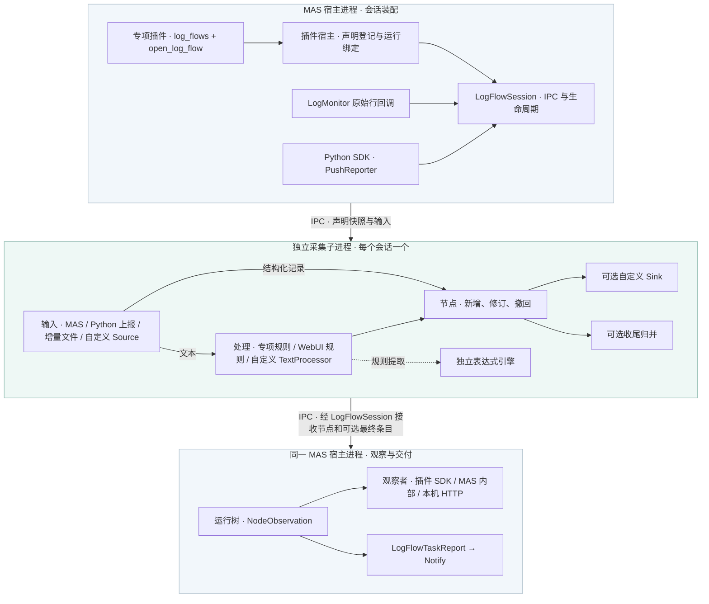
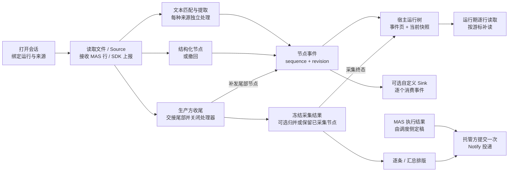

# LogFlow 现有架构与接入手册

依据 `feat/logflow` 的当前实现。适用于在 MAS 插件中接入日志节点，或在本机读取已接入运行的节点。内置任务保留原采集、报告和通知链路，通用脚本继续兼容旧标记回传。图中的 LogFlow 路径由已登记并显式打开会话的插件触发。模拟插件、SDK wheel 和专项旁路各自的验证范围见[进度表](logflow-progress.md)和[开发记录](logflow-development-log.md)。

## 架构图



宿主把观察状态挂在实际的托管运行或账号运行上。一个运行节点绑定一次会话。插件提交不携带任务、账号或来源身份。插件的表达式函数、预处理、文本处理器、后置归并、自定义 Source 和 Sink 均由 worker 加载并执行；MAS 日志监控、节点缓存和通知交接由宿主负责。

## 数据流图



“逐条”和“汇总”是**结束后的两种通知排版**。运行期间已经产出的节点从观察接口获取。节点 `status`、采集 `close_reason`、MAS 执行结果分别由节点、会话、任务树提供。即使采集超时，已送达宿主的节点仍可补读，启用的节点报告会附上“⚠️ 节点采集不完整”。

## 1. 默认接入 · MAS 原生日志 + 通知

代码放在已有的 `ScriptAdapterPlugin` 中，保留专项既有注册、调度和业务执行。这里用 `log_flows` 的一条声明表达默认 Flow。插件沿用当前日志监控器并提供命中正则及提取表达式。调用侧负责根据本轮配置决定是否采集，以及何时提交最终任务报告。

```python
from contextlib import AsyncExitStack

from auto_mas_core import ScriptAdapterPlugin
from auto_mas_core.log_flow import (
    LineRule,
    LogFlowTaskReport,
    PluginFlowDeclaration,
    SimpleFlowDeclaration,
    open_log_flow,
)
from auto_mas_core.notify import TaskResultReport


class Adapter(ScriptAdapterPlugin):
    # 专项原有的 script_type_key、decl 及执行方法放在同一插件类。
    log_flows = {
        "progress": PluginFlowDeclaration(
            rules=SimpleFlowDeclaration(
                rules=(
                    LineRule(
                        match=r"^完成：",
                        extract=r"$(完成：(.+))",
                        node_type="步骤",
                        status="success",
                    ),
                    LineRule(match=r"^失败：", node_type="步骤", status="failed"),
                ),
            ),
        ),
    }


async def run_account(
    plugin, user_run, monitor, execute, task_report, *, collect_nodes, mode
):
    async with AsyncExitStack() as stack:
        flow = None
        if collect_nodes:
            flow = await stack.enter_async_context(
                open_log_flow(
                    plugin,
                    "progress",
                    run=user_run,
                    monitor=monitor,
                    task_report=task_report,
                    mode=mode,
                )
            )
        try:
            # execute() 负责启动脚本和监控器，按原有逻辑生成业务结果。
            return await execute(flow)
        finally:
            # 保持回调有效，先交接监控器尾部，再退出 Flow。
            await monitor.stop()


async def publish_result(task_report: LogFlowTaskReport, report: TaskResultReport):
    return await task_report.send(title="专项执行结果", report=report)
```

托管层用 `task_report = LogFlowTaskReport(script_run)` 创建一次报告对象，传给本次托管下的账号会话。所有参与会话退出、业务报告定稿后调用 `publish_result`。专项自定义排版可以用 `details_for(run, statuses={"failed", "exception"})` 选取关注状态，再用 `send(..., append_details=False)` 交给 Notify。默认报告包含最终有效节点，省略仍在进行中的节点。Notify 根据托管结果与用户设置决定整份报告的发送时机。

| `open_log_flow(plugin, name, *, ...)` | 用法 |
| --- | --- |
| `plugin`, `name`, `run` | 当前启用的真实插件实例、已登记的声明名、宿主传入的 `TaskScriptItem` 或 `TaskUserItem` |
| `monitor` | `use_mas_log=True` 时，传入用 `auto_mas_core.log_flow.LogMonitor` 创建的监控器。它复用原生日志的显示回调，但有独立的订阅、轮转和尾部读取逻辑。同一监控器的原始行回调需留给本次会话 |
| `file_input` | 声明 `use_run_file=True` 时必传。固定文件放在声明的 `file` |
| `mode`, `task_report` | `逐条`、`汇总`、`关闭`。启用节点通知需绑定报告。省略模式时，有报告默认汇总，否则关闭。关闭模式仍可观察节点 |
| `general_rules` | 声明为 `GeneralFlowDeclaration` 时可覆盖本轮 WebUI 规则快照 |
| `postprocess_options` | 后置归并声明为工厂时可传 JSON 键值，同名键覆盖工厂默认值 |
| `async with … as flow` | 进入时打开会话，退出时有限收尾，返回 `FlowAccess`。启动故障可表现为带 `worker_error` 的可读会话 |

文件监控可通过 `initial_offset` 提供同一文件在启动前的字节长度。偏移有效时，从该位置起视为本轮日志。监控期间等待半行写完整，末次读取和已轮转文件的排空会接收无换行的尾行。

`send(*, title, report, append_details=True)` 返回 Notify 的 `DispatchResult`。同一托管运行重复提交时会去重。通知仍受现有 Notify 设置、筛选和异步投递流程控制。

## 2. 内置声明与混合来源

| 声明 | 可用字段和行为 |
| --- | --- |
| `PluginFlowDeclaration` | `rules=SimpleFlowDeclaration()`，`use_mas_log=True`，`accept_push=False`。可按会话组合 MAS、文件、主动上报、自定义来源。可加一个自定义 Sink |
| `SimpleFlowDeclaration` | `rules` 按顺序匹配单行，首个产出胜出。另可加 `windows`，每条窗口规则独立出结果。支持 `preprocess`、`functions`、`postprocess`、`report_order`，或以 `processor` 接管文本处理 |
| `LineRule(match, node_type, extract="", status="info")` | 模型用关键字参数。用 Python 正则匹配。提取留空时取匹配行，提取表达式用 `$()`，在正则内用捕获组指定正文 |
| `WindowRule(start, node_type, end=None, extract="", max_lines=50, status="info")` | 同时最多声明 16 条。单个窗口允许 2–100 行，遇到结束行、下个起点、上限或会话关闭时结算。窗口按来源分别维护 |
| `GeneralFlowDeclaration(patterns, hooks="")` | `patterns` 和 `hooks` 沿用 WebUI 持有的字符串格式。由执行侧传本次运行配置快照。有效的 MAS 日志时间前缀按旧排版保留 |
| `FileInput(path, start_from_end=True, rotated_name=None, start_cursor=None)` | 走 worker 文件增量读取，支持轮转。默认从当前末尾起读。调用 `await FileInput(path=...).capture_start()` 可在脚本启动前固定本轮起点 |

示例同时使用 MAS 行、每次运行指定的文件和主动上报。只采集文件时加 `use_mas_log=False` 并省略 `monitor`。文件来源需要文本规则或自定义处理器。

```python
from auto_mas_core.log_flow import FileInput, GeneralFlowDeclaration

mixed = PluginFlowDeclaration(
    use_run_file=True,
    accept_push=True,
    rules=SimpleFlowDeclaration(
        rules=(LineRule(match=r"^完成：", node_type="普通"),),
    ),
)
webui = PluginFlowDeclaration(rules=GeneralFlowDeclaration(patterns="[]"))


# 把 mixed、webui 放入 log_flows 后，在专项实际执行方法中调用。
async def run_mixed(plugin, user_run, monitor, log_path, execute):
    file_input = await FileInput(path=str(log_path)).capture_start()
    async with open_log_flow(
        plugin, "mixed", run=user_run, monitor=monitor, file_input=file_input
    ) as flow:
        try:
            return await execute(flow)
        finally:
            await monitor.stop()
```

WebUI 路径用 `open_log_flow(plugin, "webui", run=user_run, monitor=monitor, general_rules=GeneralFlowDeclaration(patterns=saved_rules, hooks=saved_hooks))` 绑定本次配置。其中 `saved_rules` 和 `saved_hooks` 来自调用方已有的通用脚本配置。

## 3. Python 主动上报

`accept_push=True` 时，从同一 MAS 事件循环里的 `flow.reporter` 上报。否则该属性为 `None`。

| 方法 | 输出 |
| --- | --- |
| `text(text, *, timestamp=None)` | 一条文本，交给该来源的文本处理器 |
| `node(node_type, text, *, timestamp=None, node_id=None, status=None, attributes=())` | 直接写结构化节点。有稳定键时，同一来源重复提交该键会生成更高修订 |
| `withdraw(node_id)` | 写一条撤回事件，用上报时的原始键，例如 `daily:stamina` |

```python
from auto_mas_core.log_flow import NodeAttribute, SubmitResult


def report_stamina(flow, used: int):
    reporter = flow.reporter
    if reporter is None:
        raise ValueError("当前声明没有启用主动上报")
    result = reporter.node(
        "体力",
        f"已消耗 {used} 点",
        node_id="daily:stamina",
        status="success",
        attributes=(NodeAttribute(key="used", value=used),),
    )
    return result  # 如返回 SubmitResult.BACKPRESSURE，由调用侧在本轮稍后重试。
```

- `accepted` 表示宿主已入队。用观察接口确认是否已产出。
- `backpressure` 表示本条未入队。让出事件循环后，按本次运行的时限重试这一条。
- `too_large` 需要缩减记录。 `invalid` 需要修正输入。 `closed` 表示会话已关闭或能力已撤销。
- `timestamp` 为可转换为本地时间的 Unix 秒数，可省略。稳定键限 1–96 个 ASCII 字母、数字或 `_.:-`。观察端返回加来源前缀的键，例如 `push/daily:stamina`。
- `attributes` 最多 16 项。键以 ASCII 字母开头，后续可用字母、数字或 `_.-`，总长最多 48 字符。值支持布尔、整数、有限浮点、长度最多 256 的字符串或 `None`。

## 4. 实时观察与逐行展示

### 插件 SDK

`flow.snapshot_nodes()` 同时返回当前有效节点、游标和采集终态。适合先填充已有节点，再从快照游标补读后续变更。 `flow.read_nodes(*, after=None, limit=50)` 返回一页事件，`limit` 可取 1–100。首次省略 `after` 会读取本次会话的第一条事件。

```python
import asyncio


async def watch_nodes(flow, use_snapshot, use_event):
    # 可与脚本执行并行。观察协程需允许 Flow 先退出，才能等到终态。
    snapshot = flow.snapshot_nodes()
    use_snapshot(snapshot.nodes)
    cursor = snapshot.cursor
    while True:
        page = flow.read_nodes(after=cursor, limit=100)
        for node in page.nodes:
            use_event(node)
        cursor = page.cursor
        if page.has_more:
            continue
        if page.close_reason is not None:
            return page.close_reason
        await asyncio.sleep(0.25)
```

### MAS 内部

已有运行对象可用 `run.node_observation`。按运行 UUID 查询时，可用 `TaskManager.get_node_observation(task_id, script_run_id, user_run_id=…)`，返回 `NodeObservation | None`。在宿主事件循环中调用 `capture()` 取快照与游标，或 `read(after=…, limit=…)` 取事件页。这与插件和本机 HTTP 读取的是同一会话。宿主查询入口位于 [TaskManager](../app/core/task_manager.py)。

### 本机 HTTP

```http
GET /api/dispatch/task/{task_id}/runs/{script_run_id}/log-nodes
```

| 参数 | 说明 |
| --- | --- |
| `task_id`, `script_run_id` | 路径中的任务运行 UUID、托管运行 UUID |
| `userRunId` | 账号运行 UUID。省略时读取托管运行自身的会话，不合并子账号 |
| `sessionId` | 从上一次成功响应的 `cursor.sessionId` 取得。首次可省略 |
| `after` | 从上一次成功响应的 `cursor.sequence` 取得。默认 0，正数时须有 `sessionId` |
| `limit` | 1–100，默认 50。页面还有字节预算 |

下面用 PowerShell 演示同一运行分支的首页和下一页。 `$masBaseUrl` 使用正在运行的 MAS 本机后端地址，三个 ID 从实际调度运行树取得。

```powershell
$url = "$masBaseUrl/api/dispatch/task/$taskId/runs/$scriptRunId/log-nodes"
$first = Invoke-RestMethod "${url}?userRunId=$userRunId&limit=50"
$session = $first.cursor.sessionId
$seq = $first.cursor.sequence
$next = Invoke-RestMethod "${url}?userRunId=$userRunId&sessionId=$session&after=$seq&limit=50"
```

成功响应示例

```json
{
  "code": 200,
  "status": "success",
  "message": "操作成功",
  "nodes": [{
    "sequence": 12,
    "node_type": "体力",
    "text": "已消耗 120 点",
    "source": "push",
    "timestamp": null,
    "node_id": "push/daily:stamina",
    "revision": 2,
    "withdrawn": false,
    "status": "success",
    "attributes": [{"key": "used", "value": 120}]
  }],
  "cursor": {"sessionId": "bfb5d718-bb36-4288-88fe-b50394157823", "sequence": 12},
  "hasMore": false,
  "closeReason": null
}
```

连接、Host 及发送时的 Origin 均须符合本机回环校验。接口对正文和属性做日志脱敏。成功及路由内错误响应使用 `Cache-Control: no-store`。

| HTTP 状态 | 调用侧处理 |
| --- | --- |
| 200 | 保存返回游标。有 `hasMore` 就继续读，页面空且还在采集时可稍后轮询 |
| 403 | 请求未通过本机校验 |
| 404 | 尚无该运行的会话，或对应会话不可用、已被淘汰 |
| 409 | 游标缺少会话 ID、过期失配或超出范围。清理该分支的本地投影并从头读 |
| 422 | 路径或查询参数校验失败，例如 UUID 格式或分页范围 |

### 消费节点的规则

- 按 `sequence` 递增消费页内事件。 `node_id=null` 的事件各自成行；有 ID 的事件按 `node_id` 更新原行。 `withdrawn=true` 时移除对应行。新会话使用新的游标和行集合。
- `status` 由 LogFlow 定义，支持成功 `success`、失败 `failed`、异常 `exception`、进行中 `running`、跳过 `skipped`、警告 `warning`、信息 `info`。省略状态时使用 `info`，旧 WebUI 规则路径也使用该默认值。 `node_type` 由插件定义业务分类，正文可按需写入额外信息。观察和报告均读取结构化状态。
- SDK 使用 `session_id`、`has_more`、`close_reason`；HTTP 外层使用 `sessionId`、`hasMore`、`closeReason`，节点字段沿用示例中的下划线命名。
- 采集终态为 `complete`、`timeout`、`worker_error` 或 `capacity`。即使收到终态，也继续读到 `has_more=false`。脚本执行成败另读 MAS 任务状态。
- 活动会话与近期已结束任务可在宿主进程内补读。当前默认保留上限为结束后 30 分钟、最近 200 个任务，近期观察共用 16 MiB 预算，因此可能更早淘汰。重启后需从新的运行会话开始。
- 单行匹配即时筛选，未命中的原始行不会进入结果集。多行规则只暂存当前窗口。每会话的观察历史最多保留 4,096 条事件或 4 MiB。达到上限后停止接纳新节点，已接纳的有效节点仍可正常参与收尾归并，并标记采集不完整。单个超长节点会被跳过，后续能容纳的节点仍可接纳。

## 5. 自定义处理和下沉

常见接入只需内置声明。需要替换组件时，插件声明用 `FunctionRef(name=…, module=…, attribute=…)` 引用自己包内的顶层对象。工厂通过 `WorkerFactorySpec(factory=ref, options={...})` 接收一个 JSON 字典，返回 worker 内新对象。宿主对象、监控器和已初始化连接不能当作工厂参数传入。

| 扩展点 | 签名和执行时机 |
| --- | --- |
| `source` | 工厂返回 `Source`。 `open() -> None`，`poll() -> Iterable[InputRecord]`，`close() -> Iterable[InputRecord]`。尾批由 `close()` 交回管线 |
| `rules.processor` | 工厂返回 `TextProcessor`。可实现 `open()`，必需 `process(line) -> Iterable[ProcessorOutput]` 和 `close() -> Iterable[ProcessorOutput]`。每个来源独立实例化，与内置规则、窗口、表达式函数和预处理互斥 |
| `sink` | 工厂返回 `Sink`。 `open()`、`write(node)`、`close()`。节点先发给宿主观察，再交给 Sink。通知开关只控制内置报告路径，自定义 Sink 随声明启用 |
| `rules.preprocess` | 引用 `(str) -> str \| None` 的函数。可改写或过滤专项原始行 |
| `rules.functions` | 引用 `(text, args) -> str` 的表达式函数。用唯一的 `namespace:name` 注册，在表达式中写 `$().namespace:name()` |
| `rules.postprocess` | 引用 `PostProcessor` 函数或返回该函数的工厂，接收及返回 `list[ReportEntry]`。条目包含 `node_type`、`text`、`timestamp`、`status`。归并器可原样保留、用 `model_copy` 修订或创建条目。节点通知关闭时跳过归并 |
| `rules.report_order` | 默认 `first_seen`，可选 `last_updated`。只影响最终报告和归并器的输入顺序 |

`InputRecord` 支持 `TextRecord`、`ReportedRecord`、`WithdrawnRecord`。处理器可产出 `(node_type, text)` 或后两种结构化记录。释放资源应能处理部分初始化的情况。

```python
# 在插件自己的可导入模块中定义并引用。
from auto_mas_core.log_flow import FunctionRef, WorkerFactorySpec


class PrefixProcessor:
    def __init__(self, prefix):
        self.prefix = prefix

    def process(self, line):
        if line.startswith(self.prefix):
            yield "普通", line[len(self.prefix) :].strip()

    def close(self):
        return ()


def make_processor(options):
    return PrefixProcessor(options["prefix"])


custom = PluginFlowDeclaration(
    rules=SimpleFlowDeclaration(
        processor=WorkerFactorySpec(
            factory=FunctionRef(
                name="adapter:processor",
                module=__name__,
                attribute="make_processor",
            ),
            options={"prefix": "完成："},
        ),
    ),
)
```

正常退出会交接尾部记录、关闭处理器、生成可选的最终条目并关闭 Sink。宿主以有限时限等候并冻结采集结果。当前内部默认启动等待 5 秒，收尾等待 2 秒，进程回收可另有开销，均非插件 SDK 参数。自定义 Sink 抛出的常规异常可与节点观察隔离，Sink 阻塞导致收尾超时时则以会话终态为准。

## 代码入口

- [插件 SDK 与示例](../plugins/auto_mas_core/README.md#logflow-日志节点) · [SDK 导出](../plugins/auto_mas_core/src/auto_mas_core/log_flow.py)
- [宿主登记和会话装配](../app/core/plugin/manager.py) · [采集进程](../app/core/log_flow/worker.py) · [表达式语法](../frontend/src/views/EditView/Script/docs/expression-doc.md)
- [观察模型](../app/models/log_flow.py) · [本机路由](../app/api/dispatch.py) · [通知桥接](../app/core/log_flow/report.py)
